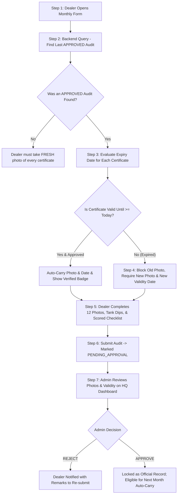

# Monthly Audit & Statutory Compliance: Step-by-Step Implementation & Execution Plan

## 1. Core Rule & Architecture Overview
This plan establishes strict integrity between **Monthly Audit Image Uploads**, **Admin Verification/Approval**, and **Statutory Expiry Lifecycle**:

1. **Admin Approval Gate for Auto-Fill:**
   - Previous certificates and images can **ONLY** be auto-filled if they originate from an audit that has `approval_status = 'APPROVED'` by Admin/Operations.
   - If previous audit was `PENDING_APPROVAL`, `REJECTED`, or missing, the dealer cannot auto-carry images and must take fresh captures.
2. **Strict Expiry Date Boundary:**
   - Even if previously approved, when a certificate's `validity_date` is crossed (`validity_date < Today`), the system **immediately revokes the auto-filled image**, clears the date field, and marks the input `required=true`.
   - The dealer is prevented from completing the audit report until a fresh photograph of the renewed certificate and the new expiry date are entered.

---

## 2. Step-by-Step Execution Plan



---

### Step 1: Initial Check on Dealer Login
When a dealer accesses the audit portal:
- The dealer's identity and assigned CMS code are authenticated.
- Geofence and GPS location are acquired and locked to verify presence at the physical fuel outlet.

### Step 2: Fetching Pre-Approved Records (Backend Engine)
In [route.ts](file:///media/yuvraj/New%20Volume/xamp/htdocs/selfaccessdashboard/src/app/api/dealer/monthly-profile/route.ts):
```sql
SELECT id, created_at, approved_at, approval_status 
FROM audits 
WHERE cms_code = ? AND approval_status = 'APPROVED' 
ORDER BY approved_at DESC, created_at DESC LIMIT 1;
```
- Only certificates linked to this **Approved Audit ID** are loaded into memory.
- If no approved audit exists, all `certificates` fields return null/empty, forcing clean capture.

### Step 3: Expiry Date Evaluation
For each statutory certificate item:
- If `validUntil >= Today`:
  - `isValid = true`
  - `photoUrl` is populated.
  - UI displays green badge: `✅ Valid until YYYY-MM-DD (Admin Approved & Verified)`.
- If `validUntil < Today` (or within 30-day grace):
  - `isExpired = true`
  - `photoUrl = ''` (Backend and Frontend scrub the expired image).
  - UI displays red alert badge: `⚠️ Certificate EXPIRED on YYYY-MM-DD! New document photo & new validity date required.`

### Step 4: Front-end Strict Enforcement
In [public/legacy/index.html](file:///media/yuvraj/New%20Volume/xamp/htdocs/selfaccessdashboard/public/legacy/index.html):
- When `isExpired === true`:
  - The date field is emptied so the dealer is forced to pick the renewed date.
  - The hidden image input `photo_data` is emptied.
  - The thumbnail preview is removed.
  - The file input element is given `required="true"`.
  - The validation loop prevents report generation if any expired certificate lacks a fresh image.

### Step 5: Monthly Operational Images Capture
The dealer takes high-resolution live camera captures of the 12 primary operational areas:
1. Full RO View
2. Sales Room Exterior
3. Main Hoarding
4. Air Dispenser
5. Drinking Water Station
6. Male Toilet
7. Female Toilet
8. FSM Shift Team
9. PESO License
10. Weights & Measures DU Certificate
11. Last Load Decantation Checklist
12. MS & HSD Decantation Point Labeling

Along with live underground fuel tank automation dip rod verification.

### Step 6: Submission & Archival
- Uploaded images are compressed and stored into:
  `/uploads/audits/{YYYY-MM}/{cms_code}/{audit_id}/...`
- Audit record is created with:
  `approval_status = 'PENDING_APPROVAL'`
  `increment_confirmed = 0`

### Step 7: HQ Admin Review & Approval Cycle
On the Admin Dashboard ([src/app/audits/[id]/page.tsx](file:///media/yuvraj/New%20Volume/xamp/htdocs/selfaccessdashboard/src/app/audits/[id]/page.tsx)):
- Admin inspects certificate legitimacy, legible validity dates, and photos.
- Upon clicking **Approve Audit**, the backend stamps:
  `approval_status = 'APPROVED'`, `approved_by = Session User`, `approved_at = CURRENT_TIMESTAMP`.
- Only now do these certificates qualify to be auto-filled for subsequent months.
